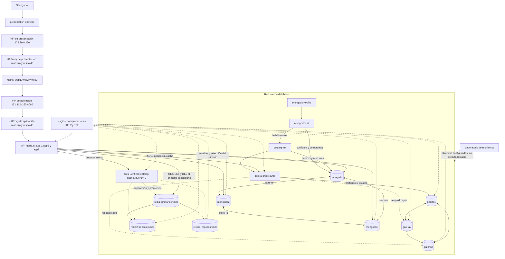

# Cambios implementados en la infraestructura de datos

## 1. Resumen ejecutivo

Este documento describe el estado encontrado en el repositorio al elaborar la documentación y lo compara con el commit `10c8832c2637e9470cdb3decb074d49e71846b05`. Las mejoras de infraestructura están en el árbol de trabajo, todavía sin confirmar en Git.

Se identificaron tres cambios principales:

1. **MongoDB:** sustitución de la conexión a una instancia independiente por un conjunto de réplicas autenticado de tres miembros, denominado `store-rs`.
2. **Redis:** incorporación de dos réplicas y tres procesos Sentinel; definición explícita de Redis como caché descartable, sin persistencia RDB/AOF, y adaptación de la API para consultar MariaDB cuando la caché no está disponible.
3. **MariaDB Galera:** incorporación de `galera-proxy`, un HAProxy con comprobaciones SQL del estado Galera. La API y el inicializador dejan de utilizar `galera1` como destino directo. Se documentan y parametrizan límites de conexiones.

También se ampliaron los objetivos de Nagios, los grupos del laboratorio de caos, la documentación y las simulaciones locales. **No se encontró una implementación de respaldos/restauración de MariaDB, ni monitorización completa de su operación.** Las variables de Mariabackup y los chequeos TCP ya existían antes de estos cambios.

La existencia de configuración no demuestra disponibilidad real. Hay evidencia de 19 pruebas locales satisfactorias en la sesión de implementación, pero no de elecciones, recuperación o conmutación satisfactorias con los servicios reales. Además, el primer arranque reportado falló en `mongodb-init`; el defecto del script fue corregido después, sin que se haya acreditado aquí un nuevo arranque exitoso.

**Regla de esta tarea documental:** únicamente se crea este archivo. No se ejecutan servicios, pruebas de carga, migraciones ni comandos sobre bases de datos, ni se cambian código, configuraciones o dependencias.

## 2. Alcance de las modificaciones

### 2.1 Alcance funcional identificado

Los cambios corresponden a los puntos 2.1, 2.2 y 2.3 de `ToDo.md` y a todo su apartado 3. La revisión documental también examina las tareas de monitorización y respaldos de MariaDB, aunque no estaban incluidas en esa implementación.

| Mejora | Evidencia encontrada | Estado que puede sostenerse |
|---|---|---|
| MongoDB con redundancia | Tres miembros, archivo de clave compartida, inicializador y URI de réplica | Implementado en archivos; operación real pendiente |
| Redis con alta disponibilidad | Tres nodos de datos y tres Sentinel, quórum 2 | Configuración y cliente implementados; conmutación pendiente |
| Política de persistencia Redis | `save ""`, `appendonly no`, TTL y consulta alternativa a SQL | Decisión implementada: caché descartable |
| Monitorización MariaDB | TCP previo en Nagios y nuevas comprobaciones SQL en el proxy | Parcial; selección de nodos no equivale a monitorización integral |
| Respaldos/restauración MariaDB | Propuestas en documentación y tareas todavía pendientes | No implementado de forma verificable en el repositorio |
| Eliminar destino directo `galera1` | `DB_HOST: galera-proxy` compartido por API e inicialización | Implementado en configuración |
| Proxy consciente del clúster | HAProxy ejecuta un comprobador SQL externo | Implementado; funcionamiento del contenedor pendiente |
| Enrutamiento de lecturas/escrituras | Nodo preferido y dos servidores de respaldo | Política definida e implementada en configuración |
| Pools y límites | Parámetros de entorno, cola finita y límites HAProxy | Implementados; dimensionamiento empírico pendiente |

### 2.2 Lo que esta implementación no hizo

- No creó los tres nodos Galera: ya existían en la referencia Git.
- No cambió la imagen de MariaDB Galera, el esquema `database/catalog.sql` ni los volúmenes originales de MariaDB.
- No implementó Swarm, Kubernetes ni distribución física entre hosts.
- No incorporó un proveedor administrado para MongoDB o Redis.
- No añadió respaldo programado, retención, almacenamiento externo o restauración automatizada.
- No implementó autenticación/TLS de Redis ni una cuenta MongoDB de mínimo privilegio.
- No eliminó el punto único representado por el proxy SQL o por el host Compose.

Los marcadores `[x]` del ToDo se acompañan de una advertencia: expresan existencia de implementación, no aceptación operativa demostrada.

## 3. Referencia Git utilizada para comparar

### 3.1 Referencia verificable

- **Rama inspeccionada:** `gustavo`.
- **HEAD:** `10c8832c2637e9470cdb3decb074d49e71846b05`.
- **Asunto de HEAD:** `doc: nuevos docs y specs de nodos`.
- **Fecha del commit:** 23 de octubre de 2026, 10:28:42, desplazamiento UTC−05:00.
- **Comparación:** archivos versionados del árbol de trabajo frente a HEAD; archivos nuevos inspeccionados directamente.

Se revisaron `git status --short`, `git diff`, `git diff --cached`, listados de archivos nuevos y el historial reciente. Se usaron también `git show`, `git log --name-status` y lecturas con numeración de líneas para corroborar el contenido y su ubicación.

**Resultado inicial:** 12 archivos versionados modificados, 10 archivos nuevos no seguidos y ningún cambio preparado en el índice. No se detectaron archivos eliminados en este conjunto. El documento actual se añade como un archivo nuevo adicional y no forma parte de las cifras de la implementación previa.

`git diff` no incluye por sí solo el contenido de archivos no seguidos; por ello los scripts nuevos y las configuraciones del proxy se leyeron individualmente. `git diff --cached` no mostró cambios. No hay un commit de esta implementación que permita atribuir autoría únicamente mediante Git: su alcance se relaciona con la sesión previa y se corrobora con los archivos existentes, sin atribuirle automáticamente cambios históricos.

### 3.2 Cambios históricos que no pertenecen a esta implementación

| Commit | Contenido comprobado en el historial | Tratamiento |
|---|---|---|
| `10c8832` | Seis documentos nuevos en `docs/`, incluidos contexto, contratos y especificaciones | Preexistentes; no atribuidos a esta implementación |
| `aaf0087` | Creación de `ESTRATEGIA-HA-DR.md` | El plan ya existía; ahora solo se añade una nota de actualización |
| `cf8f9f9` | Incorporación del laboratorio de resiliencia | El laboratorio ya existía; solo se adaptan grupos, selector y plan |
| `92afcb0` | Servicio de entrada de presentación, configuración HAProxy y ajuste Keepalived | No es una mejora nueva de esta implementación |
| `de421ed` | Diagrama de arquitectura del README | Diagrama previo posteriormente actualizado |
| `399ff7a` | Primera versión de aplicación, Galera, Redis, MongoDB y monitorización | Base funcional histórica |

En particular, `presentation-entry` ya publicaba el puerto 80. El cambio del README corrige una descripción desactualizada; no demuestra que ese servicio se haya creado ahora.

### 3.3 Límites de la comparación

Los archivos nuevos no tienen una versión anterior en HEAD; se documentan como incorporaciones. La corrección posterior de `assert.commandWorked` en el inicializador MongoDB se conserva dentro de un archivo no seguido: Git no registra una revisión intermedia de ese defecto. La evidencia del fallo y de su corrección procede de la sesión de diagnóstico y del contenido actual del script, respectivamente.

No se inspeccionaron valores de `.env` ni claves de los contenedores. `.env.example`, `database/catalog.sql` y `resilience-lab/docker-compose.yml` no muestran diferencias frente a HEAD.

## 4. Tabla general de archivos modificados

Las referencias de línea de este documento corresponden al contenido inspeccionado; pueden desplazarse al editar los archivos posteriormente.

| Archivo | Tipo | Estado Git inicial | Cambio principal |
|---|---|---|---|
| `docker-compose.yml` | Modificado | Sin preparar | Nuevos miembros, Sentinel, inicialización, proxy, variables y volúmenes |
| `application/index.js` | Modificado | Sin preparar | Clientes de datos, caché tolerante a fallos, salud y pool |
| `application/init-db.js` | Modificado | Sin preparar | Conexión SQL compartida al proxy y MongoDB replicado |
| `application/Dockerfile` | Modificado | Sin preparar | Copia de los dos módulos nuevos usados en ejecución |
| `application/package.json` | Modificado | Sin preparar | Comando de pruebas; dependencias sin cambios |
| `application/data-config.js` | Creado | No seguido | Construcción y validación de configuración de datos |
| `application/catalog-cache.js` | Creado | No seguido | Encapsulamiento de caché y límites de espera/trabajo pendiente |
| `application/data-ha.test.js` | Creado | No seguido | Simulaciones locales sin bases de datos |
| `mongodb/init-replica.js` | Creado | No seguido | Inicialización y comprobación del conjunto de réplicas |
| `redis/start-node.sh` | Creado | No seguido | Configuración de nodos Redis y política descartable |
| `redis/start-sentinel.sh` | Creado | No seguido | Configuración persistente de Sentinel |
| `database/galera-proxy/Dockerfile` | Creado | No seguido | Imagen HAProxy con cliente MariaDB |
| `database/galera-proxy/haproxy.cfg` | Creado | No seguido | Selección de servidor SQL por salud y prioridad |
| `database/galera-proxy/check-galera.sh` | Creado | No seguido | Criterios SQL de aptitud Galera |
| `nagios/architecture.cfg` | Modificado | Sin preparar | Ocho objetivos adicionales de comprobación TCP |
| `resilience-lab/chaosmonkey/chaosmonkey.py` | Modificado | Sin preparar | Grupos de datos ampliados y protección de inicializadores |
| `resilience-lab/dashboard/app.py` | Modificado | Sin preparar | Selección del grupo Sentinel |
| `resilience-lab/TEST-PLAN.md` | Modificado | Sin preparar | Expectativas y escenarios de aceptación actualizados |
| `README.md` | Modificado | Sin preparar | Nueva topología y corrección del recorrido de entrada |
| `ToDo.md` | Modificado | Sin preparar | Marcadores y explicación del alcance implementado |
| `ESTRATEGIA-HA-DR.md` | Modificado | Sin preparar | Nota que distingue implementación y propuesta futura |
| `DATA-HA.md` | Creado | No seguido | Guía operativa de datos, límites y verificaciones pendientes |

**Archivo adicional de esta tarea:** `CAMBIOS_IMPLEMENTADOS.md`, creado exclusivamente para documentar lo anterior. No se cambió el estado de preparación de los demás archivos.

## 5. Cambios implementados en Redis

### 5.1 Estado anterior y problema

En HEAD existía únicamente el servicio `redis`, con la imagen `redis:7-alpine` y una comprobación `redis-cli ping`. La API construía un cliente hacia `REDIS_HOST`/`REDIS_PORT`, esperaba su conexión al arrancar y lo incluía como dependencia obligatoria en `/health`.

En el catálogo, un error de lectura o escritura de Redis alcanzaba el manejador general de errores. Incluso después de consultar correctamente MariaDB, un fallo al almacenar el resultado en caché podía impedir responder al usuario. No había Sentinel, réplicas ni una política explícita RDB/AOF en los archivos del proyecto. Esta última ausencia no permite deducir qué persistencia tenía un contenedor ya ejecutado a partir de los valores predeterminados de su imagen.

### 5.2 Solución y funcionamiento

Se conservó `redis` como nodo primario inicial y se añadieron `redis2` y `redis3` como réplicas iniciales. Se añadieron `redis-sentinel1`, `redis-sentinel2` y `redis-sentinel3`, que vigilan el grupo `catalog-cache` con quórum 2.

El rol de cada nodo puede cambiar: los nombres de servicio no indican necesariamente quién es el primario después de una elección. La API utiliza `createSentinel(sentinelOptions())` y tres direcciones semilla; deja de conectarse a una dirección fija del primario.

| Parámetro | Valor declarado | Explicación |
|---|---|---|
| `replicaof` | `redis 6379` en nodos secundarios nuevos | Establece la replicación inicial |
| `sentinel monitor` | `catalog-cache redis 6379 2` | Define el primario inicial y el quórum de detección |
| `down-after-milliseconds` | 5000 | Umbral de sospecha de caída; no es garantía de recuperación en cinco segundos |
| `failover-timeout` | 30000 | Parámetro de coordinación de conmutación; no es un RTO garantizado |
| `parallel-syncs` | 1 | Limita la resincronización simultánea configurada por Sentinel |
| Resolución/anuncio | Nombres de host habilitados | Permite utilizar los nombres de servicio Docker |
| `masterPoolSize` / `replicaPoolSize` | 1 / 0 | Las operaciones de caché, incluidas lecturas, se dirigen al primario |
| `maxCommandRediscovers` | 1 | Acota las rediscoveries por comando según el cliente |
| Conexión a nodos/Sentinel | 1000 ms | Plazo declarado de establecimiento de socket |

El chequeo Sentinel utiliza `SENTINEL CKQUORUM catalog-cache`. La opción `redis-cli -e` solicita una salida de error cuando el servidor devuelve un error. Esto es más específico que comprobar solamente que el puerto está abierto, pero aquí no se ha observado su resultado real.

**Archivos:** `docker-compose.yml`, `redis/start-node.sh`, `redis/start-sentinel.sh`, `application/data-config.js`, `application/catalog-cache.js` y `application/index.js`.

### 5.3 Política de persistencia: datos descartables, topología conservada

Se decidió que Redis no es una fuente de verdad. El catálogo permanece en MariaDB y la entrada cacheada tiene TTL de 60 segundos.

- `save ""` desactiva las instantáneas automáticas RDB configuradas por esos puntos de guardado.
- `appendonly no` desactiva AOF.
- `maxmemory 128mb` limita la memoria de datos configurada por nodo; no es un límite global de memoria del contenedor.
- `maxmemory-policy allkeys-lru` permite expulsar claves para respetar ese límite.

Se añadieron seis volúmenes `*-state`, uno por nodo Redis o Sentinel. Conservan los archivos de configuración reescritos: dirección del primario, roles e identidad/topología de Sentinel. Los scripts crean esos archivos únicamente si no existen y no los sobrescriben en cada arranque.

**Persistencia de configuración no significa persistencia del conjunto de datos.** La configuración no garantiza conservar los valores cacheados tras reiniciar todos los nodos. Tampoco se comprobaron los contenidos de volúmenes ya existentes. La replicación asíncrona puede perder escrituras o invalidaciones recientes durante una conmutación; por eso el contrato actual admite una caché vacía o temporalmente antigua hasta su expiración.

### 5.4 Cambios de aplicación y degradación controlada

`createCatalogCache()` encapsula la interacción con Redis:

1. Inicia la conexión sin bloquear el arranque de la API por Redis.
2. Evita iniciar varias conexiones simultáneas y establece una espera de dos segundos antes de un nuevo intento después de un rechazo, cuando el estado del cliente permite reconectar.
3. Comprueba `isReady`, la pausa de operaciones y un máximo de 64 operaciones pendientes por proceso.
4. Usa una carrera de promesas para dar a cada operación un presupuesto de espera de 250 ms.
5. Devuelve `{ available: false }` ante errores o indisponibilidad, para que el catálogo consulte SQL.
6. Después de un timeout deja de enviar trabajo nuevo mientras queden operaciones pendientes; vuelve a permitirlo cuando terminan.

El timeout no cancela necesariamente el comando subyacente. Una operación puede completarse después de responder por otra vía. Además, la lectura y la escritura de caché tienen presupuestos independientes: 250 ms no representa un límite total de la petición HTTP.

`GET /products/cheapest` devuelve el resultado SQL aunque no pueda guardarlo en Redis. Un JSON cacheado inválido o que no sea un arreglo también provoca consulta a SQL. `POST /cache/clear` elimina únicamente `store:products:cheapest` y devuelve 503 cuando no puede confirmar la eliminación. No hay un vaciado global de Redis.

`GET /health` deja de ejecutar `redis.ping()`. Informa el estado de caché mediante `redis.isReady`; esta propiedad es una señal del cliente, no una prueba activa de que el último comando o la replicación funcionen.

### 5.5 Beneficios, límites y verificación pendiente

**Beneficios implementados:** descubrimiento del primario, capacidad configurada de promoción y una ruta de catálogo que no convierte un fallo de caché en fallo SQL. Las simulaciones locales cubren esa ruta alternativa.

**Limitaciones:** no hay autenticación/TLS de Redis; `protected-mode no` requiere preservar el aislamiento de la red `database`. No se implementó protección distribuida contra múltiples fallos de caché simultáneos. Todos los nodos comparten un host. No se ha demostrado la recuperación del cliente Sentinel después de todas las combinaciones de reinicio.

**Cómo verificar posteriormente:** identificar el primario real mediante Sentinel, detenerlo en un entorno descartable, observar promoción y redescubrimiento, y comprobar lectura/repoblación. Probar también la caída de todos los nodos Redis, el retorno del servicio y la conservación de topología después de reiniciar sin borrar volúmenes. No se ejecutan estos experimentos durante esta documentación.

## 6. Cambios implementados en MariaDB

### 6.1 Monitorización: elementos previos y ampliaciones

**Antes:** los tres nodos Galera ya tenían comprobaciones TCP de Nagios en el puerto 3306 y comprobaciones de salud Compose basadas en `mariadb-admin ping`. Esos mecanismos no se añadieron en esta implementación.

**Problema:** un puerto abierto o un servidor que responde no acredita que ese nodo pertenezca al componente primario, esté sincronizado o pueda aceptar las operaciones previstas.

**Ahora:** el proxy ejecuta comprobaciones SQL de aptitud antes de utilizar un nodo. Nagios incorpora además un objetivo TCP para `galera-proxy`. Esto permite distinguir parcialmente proceso accesible y candidato apto para enrutamiento.

**Archivos:** `database/galera-proxy/check-galera.sh`, `database/galera-proxy/haproxy.cfg`, `nagios/architecture.cfg` y `docker-compose.yml`.

**Estado:** monitorización parcial. No se encontraron nuevas métricas históricas de tamaño/quórum del clúster, colas de replicación, control de flujo, saturación, uso de disco o estado de backups, ni un recolector de métricas añadido por estos cambios. Los chequeos TCP previos de MariaDB siguen siendo TCP.

**Beneficio y límite:** el proxy puede descartar un candidato por estado SQL; eso no acredita que Nagios alerte correctamente, que exista observación externa al host o que el servicio cumpla un SLO.

**Cómo verificar posteriormente:** comparar estado SQL de cada nodo, decisiones de HAProxy y estado de Nagios; simular un nodo accesible pero no apto y comprobar que el proxy lo excluya. Las pruebas locales del comprobador solo validan su interpretación de respuestas simuladas.

### 6.2 Respaldos y restauración: pendientes

No se identificó un servicio de respaldo, script de exportación, calendario, destino externo, política de retención o procedimiento de restauración automatizado incorporado por esta implementación. Los volúmenes `galera1-data`, `galera2-data` y `galera3-data` ya existían y permanecen declarados.

Las variables `MARIADB_GALERA_MARIABACKUP_USER` y `MARIADB_GALERA_MARIABACKUP_PASSWORD` también son previas. Su presencia como configuración del clúster no equivale a una tarea periódica de backup de negocio ni demuestra disponibilidad de una copia recuperable. La transferencia de estado entre miembros y un respaldo independiente resuelven problemas distintos.

`ESTRATEGIA-HA-DR.md` propone copias fuera de los hosts y restauraciones periódicas, pero sigue siendo una estrategia. `ToDo.md`, líneas 26–27, mantiene sin completar las tareas de monitorización/plan de respaldo y de pruebas periódicas de restauración.

**Estado anterior:** persistencia local y propuestas; recuperación independiente no acreditada.

**Estado actual:** sin implementación adicional verificable de respaldo/restauración. Podrían existir mecanismos externos al repositorio, pero no fueron examinados ni se presuponen.

**Beneficio obtenido en este punto:** aclaración documental de la brecha, no una garantía nueva de recuperación.

**Cómo verificar posteriormente:** solicitar inventario de copias, calendario, retención, responsable y objetivos RPO/RTO; restaurar una copia en un entorno aislado y comprobar integridad. Ese ejercicio debe ejecutarse con autorización específica sobre datos de ensayo. En este documento no se incorpora un componente ficticio de respaldo al diagrama.

## 7. Cambios implementados en Galera y su proxy

### 7.1 Eliminación del acceso directo desde los clientes

En HEAD, el entorno compartido de las API establecía `DB_HOST: galera1`. `catalog-init` heredaba ese mismo entorno. La réplica del clúster no proporcionaba a esos clientes un destino alternativo automático.

Ahora `DB_HOST` vale `galera-proxy`. `sqlOptions()` lo utilizan tanto `mysql.createPool()` de la API como `mysql.createConnection()` del inicializador. Las referencias a `galera1` permanecen correctamente en la topología y en la lista de servidores del proxy: eliminar el acceso directo de aplicación no significa eliminar el nodo.

**Beneficio:** el código cliente deja de necesitar la dirección de un miembro específico para establecer conexiones SQL. **Límite:** la disponibilidad real del nuevo endpoint depende de un único contenedor proxy.

### 7.2 Comprobación de aptitud Galera

El proxy utiliza HAProxy en modo TCP y ejecuta `check-galera.sh` para cada servidor. El script recibe dirección y puerto en sus argumentos tercero y cuarto, utiliza el usuario SQL del catálogo y suministra la contraseña al cliente mediante `MYSQL_PWD`, no como argumento visible en la línea de comandos.

La consulta debe completarse dentro del límite externo de cuatro segundos; el establecimiento de conexión MariaDB tiene dos segundos. El resultado es apto únicamente si se cumplen todos estos criterios:

| Estado | Valor exigido | Significado para el enrutamiento |
|---|---|---|
| `wsrep_cluster_status` | `Primary` | Pertenece al componente primario del clúster |
| `wsrep_connected` | `ON` | Está conectado al proveedor de replicación |
| `wsrep_ready` | `ON` | Informa disponibilidad para consultas |
| `wsrep_local_state` | `4` | Está en estado sincronizado |
| `@@GLOBAL.read_only` | `0` | No está configurado como solo lectura |
| `@@GLOBAL.wsrep_on` | `1` | Replicación wsrep habilitada globalmente |
| `@@GLOBAL.wsrep_desync` | `0` | No está marcado globalmente como desincronizado |

Una consulta fallida, una respuesta incompleta o un criterio distinto produce salida no cero. El script no cambia variables SQL ni repara el clúster. El estado global tampoco demuestra el comportamiento causal de todas las sesiones de aplicación.

**Referencia:** `check-galera.sh`, líneas 4–15. La consulta real, sus permisos y el formato devuelto por la imagen de cliente todavía requieren aceptación con servicios reales.

### 7.3 Política de lecturas y escrituras

No hay separación de consultas por su texto ni un endpoint de lectura distinto. Todas las conexiones SQL usan el mismo backend:

1. `galera1` es el servidor preferido mientras sea apto.
2. `galera2` y `galera3` son servidores de respaldo, declarados en ese orden.
3. No se habilita `allbackups`; la configuración pretende seleccionar un respaldo disponible cuando falta el preferido.
4. Al marcar un servidor como caído, `on-marked-down shutdown-sessions` cierra sus sesiones para permitir conexiones nuevas por otra ruta.
5. Al recuperarse `galera1`, `on-marked-up shutdown-backup-sessions` cierra sesiones de respaldo para volver al preferido en conexiones nuevas.

Las conexiones ya abiertas no se trasladan de un servidor a otro de forma transparente. Peticiones en curso pueden fallar. El código no reintenta a ciegas una escritura SQL cuyo resultado sea ambiguo. El cierre durante retorno al preferido también puede provocar errores transitorios.

Los chequeos se programan cada tres segundos, con dos fallos o éxitos para cambiar de estado. Estos valores no garantizan un tiempo exacto de conmutación: intervienen ejecución del chequeo, timeouts y reconexión del cliente.

### 7.4 Imagen, DNS y arranque

El nuevo Dockerfile parte de `haproxy:3.2-alpine`, instala `mariadb-client` durante la construcción y termina con el usuario `haproxy`. La instalación está declarada en el Dockerfile; no se ejecutó al documentar.

Se habilitan `external-check preserve-env` e `insecure-fork-wanted` para ejecutar el comprobador fijo y darle acceso al entorno. Esto amplía capacidades del proceso respecto a la prohibición predeterminada de crear procesos; debe limitarse al proxy privado y a un script controlado.

El resolvedor `127.0.0.11:53` permite renovar resoluciones de nombres Docker. El proxy no publica el puerto SQL al host y permanece en `database`.

Compose exige que los tres contenedores Galera estén saludables antes de iniciar el proxy. Después, `catalog-init` espera que el proxy esté iniciado, no una comprobación SQL de disponibilidad de ese servicio. La función `connectToMariaDb()` reintenta ciertos errores de conexión hasta 30 veces, esperando dos segundos entre intentos; los timeouts añaden duración a ese ciclo.

**Limitación:** el orden de arranque inicial es más exigente que la política de operación ante una caída posterior. Tampoco se automatiza el bootstrap tras pérdida completa del clúster ni se demuestra consistencia causal de lecturas entre nodos después de una conmutación.

## 8. Configuración de conexiones y pools

### 8.1 Variables de entorno relacionadas

No se publican valores de credenciales. Los nombres siguientes se verificaron en código/Compose, no leyendo secretos locales.

| Variable | Antes | Ahora / función |
|---|---|---|
| `DB_HOST` | `galera1` | `galera-proxy` |
| `DB_PORT` | 3306 | Se conserva; entero positivo validado |
| `DB_POOL_LIMIT` | No existía | Predeterminado 10 por proceso API |
| `DB_QUEUE_LIMIT` | No existía | Predeterminado 20 adquisiciones pendientes por proceso |
| `DB_CONNECT_TIMEOUT_MS` | No explícita en el proyecto | Predeterminado 3000 ms |
| `DB_NAME`, `DB_USER`, `DB_PASSWORD` | Existían | Se conservan; acceso mediante `sqlOptions()` |
| `MONGO_HOST`, `MONGO_PORT` | Un host/puerto | Sustituidos en el entorno de aplicación |
| `MONGO_HOSTS` | No existía | Tres miembros como direcciones semilla |
| `MONGO_REPLICA_SET` | No existía | `store-rs` |
| `MONGO_DB`, `MONGO_USER`, `MONGO_PASSWORD` | Existían | Se conservan; la cuenta sigue siendo administrativa |
| `REDIS_HOST`, `REDIS_PORT` | Destino fijo | Sustituidos por configuración Sentinel |
| `REDIS_SENTINELS` | No existía | Tres direcciones semilla en el puerto 26379 |
| `REDIS_MASTER_NAME` | No existía | `catalog-cache` |
| `REDIS_NODE_HOST` | No existía | Nombre anunciado por cada nodo de datos |
| `REDIS_SENTINEL_HOST` | No existía | Nombre anunciado por cada Sentinel |

Las tres variables nuevas de pool/plazo SQL admiten sustitución desde el entorno mediante Compose; tienen valores predeterminados aunque `.env.example` no se haya ampliado. Los nombres de miembros/grupos se fijan en Compose y scripts; no todos son parámetros libres intercambiables.

### 8.2 Límites SQL y presupuesto

`positiveInteger()` rechaza cero, negativos y valores no enteros para los parámetros que valida. La API mantiene `waitForConnections: true`, cambia la cola a finita y establece:

| Parámetro | Valor predeterminado | Alcance |
|---|---:|---|
| `connectionLimit` | 10 | Conexiones por proceso API |
| `queueLimit` | 20 | Peticiones en espera de una conexión por proceso |
| `maxIdle` | Igual a `DB_POOL_LIMIT` | Conexiones ociosas admitidas |
| `idleTimeout` | 30000 ms | Tiempo de inactividad de conexiones del pool |
| `connectTimeout` | 3000 ms | Establecimiento de conexión SQL |
| HAProxy `maxconn` global | 120 | Conexiones entrantes al proxy |
| HAProxy `maxconn` por servidor | 100 | Conexiones enrutadas al nodo elegido |
| HAProxy `timeout queue` | 3 s | Espera en cola del proxy |

Antes `connectionLimit` ya era 10; la mejora consiste en hacerlo configurable y explicitar el presupuesto, no en haberlo reducido. Con tres API el máximo nominal es `3 × 10 = 30` conexiones de pool. La inicialización usa una conexión directa al proxy y los comprobadores abren conexiones adicionales breves a los nodos. Durante un despliegue pueden coexistir procesos y tareas; se necesita margen para administración y trabajos externos.

La configuración no modifica `max_connections` de MariaDB. Antes de escalar debe compararse `réplicas API × DB_POOL_LIMIT` con los límites del proxy y la capacidad efectiva del nodo que tendrá que soportar el tráfico tras una caída. Una cola finita evita crecimiento ilimitado de adquisiciones, pero no es un plazo total de consulta SQL ni de petición HTTP.

### 8.3 MongoDB y conexiones de caché

`mongoUri()` construye una URI con tres semillas, `replicaSet=store-rs`, `readPreference=primary`, `w=majority` y `retryWrites=true`. La API declara selección de servidor de cinco segundos, conexión de tres segundos, socket de cinco segundos y espera de confirmación de mayoría de cinco segundos. El inicializador usa selección de servidor de diez segundos y la misma política de mayoría.

El conjunto tiene tres miembros con datos, sin árbitro. El archivo de clave se genera una sola vez en `mongodb-keyfile`, con propietario del usuario MongoDB y modo `0400`. Se conserva el volumen original `mongodb-data` y se añaden dos nuevos. `mongodb-init` autentica, inicia únicamente si recibe el código 94 de conjunto no inicializado, comprueba identidad/lista de miembros existentes y espera tres miembros saludables, uno primario y dos secundarios.

Esa espera de tres miembros es un requisito del trabajo inicializador; no debe confundirse con la mayoría mínima para operar después de una caída. El script tiene dos bucles de 90 intentos con esperas de dos segundos; las conexiones pueden aumentar el tiempo total.

La corrección posterior reemplazó `assert.commandWorked`, ausente en `mongosh`, por la función local `commandWorked()`. La prueba actual ya no inventa ese auxiliar en su entorno simulado. No se ha acreditado un arranque real satisfactorio después de corregirlo.

## 9. Arquitectura actualizada

El diagrama representa servicios declarados, no procesos cuya salud se haya observado durante esta documentación. Los roles Redis indicados son iniciales y pueden cambiar.



Los pares Keepalived mantienen las VIP de presentación y aplicación compartiendo el espacio de red de sus HAProxy. Esos mecanismos ya existían. En MongoDB, los enlaces representan replicación/descubrimiento, no escrituras de aplicación a los tres miembros simultáneamente. Para simplificar el diagrama, algunos objetivos TCP preexistentes de Nagios no se dibujan individualmente.

**Respaldo:** no hay un servicio implementado que pueda dibujarse como mecanismo de copias y restauración. Los volúmenes locales de MongoDB/Galera y los de configuración Redis no sustituyen ese mecanismo.

### Secuencia de arranque declarada

1. Se prepara el archivo de clave MongoDB y arrancan sus tres miembros.
2. `mongodb-init` espera sus chequeos de salud e intenta configurar/comprobar el conjunto.
3. Los tres Galera pasan sus chequeos Compose y habilitan el inicio de `galera-proxy`.
4. `catalog-init` requiere el proxy iniciado y la finalización satisfactoria de `mongodb-init`; ejecuta esquema/muestras por SQL y prepara MongoDB.
5. Las API requieren `catalog-init` satisfactorio. Su arranque espera conexión MongoDB, pero no disponibilidad de Redis.
6. Redis y Sentinel arrancan según sus propias dependencias; el catálogo puede consultar SQL mientras se forma la topología de caché.

## 10. Explicación detallada por archivo

### Archivo: `docker-compose.yml`

**Tipo de cambio:** Modificado.

**Propósito del archivo:** Declarar servicios, redes, variables, dependencias y volúmenes del despliegue local.

**Modificaciones realizadas:**

- Sustituye destinos fijos por el proxy SQL, semillas MongoDB y Sentinel.
- Añade parámetros SQL con valores predeterminados y servicios de datos/inicialización.
- Conserva volúmenes previos y añade volúmenes MongoDB y de configuración Redis.
- Amplía dependencias Nagios y retira Redis como requisito de `catalog-init`.

**Explicación técnica:** Las anclas YAML comparten entorno de API y definiciones de nodos; cada réplica sobreescribe su volumen/nombre. `service_completed_successfully` distingue tareas terminadas de procesos persistentes. El proxy utiliza únicamente la red interna.

**Relación con otros componentes:** Todos los clientes de datos, scripts nuevos, proxy y monitorización.

**Referencia:** Entorno de API, líneas 183–201; inicialización, 236–321; Redis/Sentinel, 323–398; proxy, 400–414; Nagios/volúmenes, 485–542.

### Archivo: `application/index.js`

**Tipo de cambio:** Modificado.

**Propósito del archivo:** Servidor HTTP y rutas del catálogo y reseñas.

**Modificaciones realizadas:**

- Configura pool SQL validado y MongoDB replicado.
- Sustituye cliente Redis fijo por `createSentinel()` y `createCatalogCache()`.
- Añade consulta SQL alternativa, tolerancia a caché inválida y error explícito al no poder confirmar una eliminación.
- Retira Redis de la prueba obligatoria de salud y adapta el cierre del cliente.

**Explicación técnica:** Los errores de caché se convierten en resultados de disponibilidad; los errores SQL/MongoDB continúan por el manejador general. La traza dice `galera-proxy` y no atribuye la consulta a un nodo Galera concreto que la API no puede observar.

**Relación con otros componentes:** Importa los módulos nuevos, recibe entorno de Compose y consulta SQL/MongoDB/Redis.

**Referencia:** Pool/clientes, líneas 8–33; `start()`, 69–71; salud, 84–88; catálogo, 100–120; limpieza, 123–134; búsqueda de SKU, 171–174; cierre, 212–219.

### Archivo: `application/init-db.js`

**Tipo de cambio:** Modificado.

**Propósito del archivo:** Preparar esquema y muestras SQL, índices y muestras de reseñas.

**Modificaciones realizadas:**

- Usa `sqlOptions()` y `mongoUri()` compartidos.
- Amplía errores de conexión SQL reintentables con `ECONNRESET` y `PROTOCOL_CONNECTION_LOST`.
- Declara selección MongoDB y confirmación por mayoría.

**Explicación técnica:** El entorno compartido mueve su conexión al proxy. No se cambió el contenido del esquema ni se introdujo un sistema de migraciones. El ciclo de conexión no reintenta automáticamente el SQL de inicialización una vez comenzado.

**Relación con otros componentes:** Lo ejecuta `catalog-init` después de `mongodb-init`; monta el SQL existente.

**Referencia:** `connectToMariaDb()`, líneas 6–22; clientes, 24–36; operaciones conservadas, 38–82.

### Archivo: `application/Dockerfile`

**Tipo de cambio:** Modificado.

**Propósito del archivo:** Construir la imagen de API e inicializador.

**Modificaciones realizadas:**

- Incluye `data-config.js` y `catalog-cache.js` en la copia de archivos de ejecución.
- Conserva Node 22, usuario `node` y comando de arranque.

**Explicación técnica:** Sin esa copia fallarían los imports nuevos al ejecutar la imagen. No copia el archivo de pruebas.

**Relación con otros componentes:** Imagen de `app1`, `app2`, `app3` y `catalog-init`.

**Referencia:** Línea 8.

### Archivo: `application/package.json`

**Tipo de cambio:** Modificado.

**Propósito del archivo:** Declarar dependencias y comandos Node.

**Modificaciones realizadas:**

- Añade `test: node --test data-ha.test.js`.
- Conserva los rangos de `mongodb`, `mysql2` y `redis`.

**Explicación técnica:** Las pruebas usan utilidades incorporadas de Node. No se añadió un framework de pruebas ni se actualizó una dependencia en este archivo.

**Relación con otros componentes:** Ejecución local de la suite nueva. Como el Dockerfile no copia esa suite, este comando no está disponible funcionalmente en la imagen de aplicación tal como se construye.

**Referencia:** Líneas 6–13.

### Archivo: `application/data-config.js`

**Tipo de cambio:** Creado.

**Propósito del archivo:** Centralizar configuración compartida y validaciones básicas.

**Modificaciones realizadas:**

- Añade `required()` y `positiveInteger()`.
- Construye opciones SQL y URI MongoDB.
- Construye semillas y opciones de Sentinel.

**Explicación técnica:** Las funciones aceptan un entorno inyectable para probarlas sin credenciales reales. MongoDB recibe parámetros de réplica/mayoría y Redis usa lecturas del primario, cola fuera de línea desactivada en nodos y conexión acotada.

**Relación con otros componentes:** Importado por API, inicializador y pruebas.

**Referencia:** Validación, líneas 1–13; `sqlOptions()`, 15–22; `mongoUri()`, 24–29; `sentinelOptions()`, 31–49.

### Archivo: `application/catalog-cache.js`

**Tipo de cambio:** Creado.

**Propósito del archivo:** Encapsular caché opcional y su comportamiento ante fallos.

**Modificaciones realizadas:**

- Controla conexión, reintentos y estado de cierre.
- Limita a 64 operaciones pendientes y espera predeterminada de 250 ms.
- Añade pausa tras timeout y envoltorios `get`, `set`, `del` y `close`.

**Explicación técnica:** Separa disponibilidad de caché de error de negocio. La pausa evita acumular comandos abandonados indefinidamente; la operación subyacente puede seguir activa. `set` conserva TTL de 60 segundos.

**Relación con otros componentes:** Lo consume `index.js` sobre el cliente Sentinel.

**Referencia:** `createCatalogCache()`, línea 2; conexión, 9–14; `command()`, 16–42; interfaz, 44–53.

### Archivo: `application/data-ha.test.js`

**Tipo de cambio:** Creado.

**Propósito del archivo:** Comprobar decisiones de código sin desplegar bases o servidores.

**Modificaciones realizadas:**

- Prueba configuración, fallo/recuperación/concurrencia de caché y TTL/eliminación acotada.
- Simula nueve estados del comprobador Galera sustituyendo el subproceso SQL.
- Evalúa rutas HTTP con clientes y servidor simulados.
- Simula inicialización MongoDB con configuración nueva o existente.

**Explicación técnica:** Usa `node:test`, `vm` y subprocesos shell simulados. Elimina imports del servidor para inyectar dobles; no prueba el protocolo real de drivers ni una imagen construida. La corrección posterior retiró el doble que inventaba `assert.commandWorked` en el entorno de MongoDB.

**Relación con otros componentes:** Cubre los módulos nuevos, fragmentos de API, script Galera e inicializador MongoDB.

**Referencia:** Configuración/caché, líneas 16–78; Galera, 80–104; API simulada, 106–175; MongoDB, 177–205.

### Archivo: `mongodb/init-replica.js`

**Tipo de cambio:** Creado; corregido posteriormente dentro del mismo archivo todavía no seguido.

**Propósito del archivo:** Inicializar y comprobar `store-rs` mediante `mongosh`.

**Modificaciones realizadas:**

- Define tres miembros y autenticación administrativa.
- Inicia solo ante código 94 y rechaza una identidad/lista de miembros diferente.
- Espera miembros saludables y elección; no fuerza reconfiguración.
- Añade `commandWorked()` propio para reemplazar la función inexistente detectada en el primer arranque.

**Explicación técnica:** Consulta comandos administrativos y preserva el código de error en comprobaciones fallidas. Reintenta en dos fases. Las comprobaciones de configuración existente no validan cada posible opción de réplica, solo los campos comparados explícitamente.

**Relación con otros componentes:** Montado de solo lectura en `mongodb-init`, condiciona `catalog-init`.

**Referencia:** Auxiliar corregido, líneas 4–12; autenticación, 13–19; configuración, 21–53; espera, 55–70.

### Archivo: `redis/start-node.sh`

**Tipo de cambio:** Creado.

**Propósito del archivo:** Generar configuración inicial de cada nodo Redis.

**Modificaciones realizadas:**

- Desactiva RDB/AOF y fija memoria/expulsión.
- Anuncia el nombre del nodo y configura réplicas iniciales.
- Conserva configuración existente para permitir reescrituras de topología.

**Explicación técnica:** Escribe `/data/redis.conf` solo si falta o está vacío. `exec redis-server` reemplaza el shell. Los cambios futuros al contenido inicial del script no reemplazarán automáticamente un archivo ya conservado en volumen.

**Relación con otros componentes:** Montado en los tres nodos; utiliza `REDIS_NODE_HOST` y volúmenes `*-state`.

**Referencia:** Líneas 4–20.

### Archivo: `redis/start-sentinel.sh`

**Tipo de cambio:** Creado.

**Propósito del archivo:** Generar configuración inicial y arrancar Sentinel.

**Modificaciones realizadas:**

- Define nombre de grupo, primario inicial y quórum.
- Configura DNS, anuncio, tiempos y resincronización.
- Preserva `/data/sentinel.conf` entre arranques.

**Explicación técnica:** El archivo queda en un volumen escribible para que Sentinel pueda guardar cambios. El script arranca `redis-server` con `--sentinel` y no sustituye una configuración ya existente.

**Relación con otros componentes:** Tres Sentinel; descubrimiento desde la API y control de nodos Redis.

**Referencia:** Líneas 3–17.

### Archivo: `database/galera-proxy/Dockerfile`

**Tipo de cambio:** Creado.

**Propósito del archivo:** Preparar HAProxy para comprobaciones SQL externas.

**Modificaciones realizadas:**

- Añade `mariadb-client` a la imagen HAProxy.
- Copia configuración y comprobador con permiso de ejecución.
- Usa `haproxy` como usuario final.

**Explicación técnica:** El cliente MariaDB permite consultar estado real, en vez de utilizar solo una conexión TCP. La construcción de esta imagen no fue repetida para documentar.

**Relación con otros componentes:** Servicio `galera-proxy`.

**Referencia:** Líneas 1–8.

### Archivo: `database/galera-proxy/haproxy.cfg`

**Tipo de cambio:** Creado.

**Propósito del archivo:** Publicar el endpoint SQL interno y seleccionar candidatos.

**Modificaciones realizadas:**

- Define frontend TCP 3306 y backend Galera.
- Habilita comprobaciones externas, DNS Docker y límites de conexiones/colas.
- Declara un preferido y dos respaldos, cierre por caída y retorno al preferido.

**Explicación técnica:** Las decisiones dependen de la salida del comprobador. HAProxy no analiza sentencias SQL ni convierte consultas en transacciones distribuidas.

**Relación con otros componentes:** API/inicializador como clientes; tres Galera como destinos.

**Referencia:** Global, líneas 1–5; plazos, 7–15; DNS, 17–22; frontend/backend, 24–37.

### Archivo: `database/galera-proxy/check-galera.sh`

**Tipo de cambio:** Creado.

**Propósito del archivo:** Determinar si un nodo es apto para el backend SQL.

**Modificaciones realizadas:**

- Ejecuta consulta autenticada con límites de conexión/ejecución.
- Recoge estados wsrep y variables de escritura.
- Devuelve éxito únicamente si todos los criterios coinciden.

**Explicación técnica:** `awk` interpreta una salida tabular; no basta con obtener una respuesta del proceso MariaDB. La contraseña en entorno evita incluirla en argumentos, pero no equivale a un gestor de secretos ni impide acceso por un administrador del contenedor.

**Relación con otros componentes:** Invocado por HAProxy y evaluado con respuestas simuladas en la suite.

**Referencia:** Líneas 3–15.

### Archivo: `nagios/architecture.cfg`

**Tipo de cambio:** Modificado.

**Propósito del archivo:** Definir hosts, servicios y comandos Nagios.

**Modificaciones realizadas:**

- Añade dos miembros MongoDB, dos nodos Redis, tres Sentinel y el proxy SQL.
- Conserva las comprobaciones previas de nodos Galera.

**Explicación técnica:** Cada objetivo nuevo tiene una comprobación TCP de puerto; no se añadió una comprobación Nagios de quórum ni réplica correcta.

**Relación con otros componentes:** Nagios accede a servicios desde las redes del despliegue.

**Referencia:** Galera preexistente, líneas 171–217; objetivos nuevos, 252–385.

### Archivo: `resilience-lab/chaosmonkey/chaosmonkey.py`

**Tipo de cambio:** Modificado.

**Propósito del archivo:** Seleccionar contenedores para inyectar fallos y registrar resultados.

**Modificaciones realizadas:**

- Amplía los grupos Redis y MongoDB a sus tres miembros.
- Añade grupo `redis-sentinel`.
- Protege `mongodb-init` y `mongodb-keyfile` de selección explícita por el inyector.

**Explicación técnica:** Modifica listas de objetivos, no la lógica general de parada/restauración. El servicio `galera-proxy` no se añade a los grupos aleatorios; un ensayo específico requeriría seleccionarlo explícitamente según la herramienta.

**Relación con otros componentes:** Dashboard y servicios Compose identificados por etiquetas.

**Referencia:** `GROUPS` y `PROTECTED`, líneas 32–43.

### Archivo: `resilience-lab/dashboard/app.py`

**Tipo de cambio:** Modificado.

**Propósito del archivo:** API y definición de formularios del laboratorio.

**Modificaciones realizadas:**

- Añade `redis-sentinel` a las opciones de grupo de Chaos Monkey.

**Explicación técnica:** El selector y la validación basada en opciones permiten solicitar ese grupo. No se modifican autenticación, ejecución Docker ni límites globales del laboratorio.

**Relación con otros componentes:** Interfaz del dashboard y grupo nuevo del inyector.

**Referencia:** `TOOLS`, campo `GROUP`, líneas 76–77.

### Archivo: `resilience-lab/TEST-PLAN.md`

**Tipo de cambio:** Modificado.

**Propósito del archivo:** Definir escenarios de carga y disponibilidad esperados.

**Modificaciones realizadas:**

- Sustituye la expectativa de fallo por pérdida de `galera1` por el ensayo de selección de respaldo.
- Añade escenarios de elección/pérdida de mayoría MongoDB y caída de Sentinel.
- Actualiza puntos únicos y remite a la guía de aceptación.

**Explicación técnica:** Las tablas son expectativas de prueba; no constituyen resultados ni garantizan ausencia de errores transitorios.

**Relación con otros componentes:** Laboratorio y topología de datos nueva.

**Referencia:** Matriz, líneas 31–46; brechas, 67–73; pasos siguientes, 92–97.

### Archivo: `README.md`

**Tipo de cambio:** Modificado.

**Propósito del archivo:** Presentar el proyecto, arquitectura y arranque.

**Modificaciones realizadas:**

- Introduce réplicas de datos, Sentinel y proxy en texto/diagrama.
- Corrige la atribución del puerto público a `presentation-entry`.
- Actualiza el orden de inicialización y enlaza precauciones de volúmenes.

**Explicación técnica:** Documenta un servicio de entrada que ya existía y las nuevas relaciones de datos. La descripción no es evidencia de un despliegue satisfactorio.

**Relación con otros componentes:** Vista general de Compose y enlace a `DATA-HA.md`.

**Referencia:** Introducción, líneas 9–13; diagrama, 17–88; inicialización, 104–109; limitación de entrada, 138–140.

### Archivo: `ToDo.md`

**Tipo de cambio:** Modificado.

**Propósito del archivo:** Mantener tareas de evolución técnica.

**Modificaciones realizadas:**

- Marca puntos 2.1–2.3 y los cuatro elementos de 3 como implementados.
- Explica política Redis, proxy, presupuesto SQL y pruebas pendientes.
- Mantiene sin completar tareas de respaldo/restauración.

**Explicación técnica:** Los marcadores se interpretan con la nota explícita de aceptación pendiente; no acreditan operación productiva.

**Relación con otros componentes:** Estado de implementación y guía `DATA-HA.md`.

**Referencia:** Líneas 18–49.

### Archivo: `ESTRATEGIA-HA-DR.md`

**Tipo de cambio:** Modificado.

**Propósito del archivo:** Proponer evolución a varios equipos y recuperación ante desastres.

**Modificaciones realizadas:**

- Añade una nota de actualización sobre datos/proxy implementados.
- Reubica conceptualmente limitaciones antiguas como motivación histórica.
- Aclara que Swarm, backups, mínimos privilegios y observabilidad siguen pendientes.

**Explicación técnica:** No se creó ahora el documento ni se implementó todo su plan. La nota evita interpretar el cuerpo de la estrategia como inventario exacto del código actual.

**Relación con otros componentes:** Plan futuro y guía de operación de datos.

**Referencia:** Líneas 19–28; propuestas de datos, 206–223.

### Archivo: `DATA-HA.md`

**Tipo de cambio:** Creado.

**Propósito del archivo:** Explicar disponibilidad de datos, límites y aceptación futura.

**Modificaciones realizadas:**

- Describe conjunto MongoDB, caché descartable/Sentinel y proxy Galera.
- Documenta preservación de volúmenes y precauciones sobre datos previos.
- Define presupuesto de conexiones y matriz de pruebas pendientes.

**Explicación técnica:** Es documentación operativa, no automatización ejecutada. Distingue configuración Redis de datos de negocio y reconoce el proxy único.

**Relación con otros componentes:** Referenciado desde README, ToDo y estrategia.

**Referencia:** MongoDB, líneas 9–38; Redis, 40–72; Galera/pools, 74–126; verificación, 128–158.

### Archivo: `CAMBIOS_IMPLEMENTADOS.md`

**Tipo de cambio:** Creado en esta tarea documental.

**Propósito del archivo:** Registrar comparación Git, explicación por archivo y alcance de la evidencia.

**Modificaciones realizadas:**

- Reúne los cambios previos sin alterar su implementación.
- Separa pruebas locales históricas, inspección actual y aceptación pendiente.
- Explicita monitorización parcial y ausencia de respaldo implementado.

**Explicación técnica:** Se elabora mediante operaciones de lectura y una única escritura autorizada sobre este Markdown.

**Relación con otros componentes:** Referencias documentales a los archivos inspeccionados.

**Referencia:** Secciones 3, 4, 10 y 11 de este documento.

## 11. Validaciones realizadas y pendientes

### 11.1 Evidencia obtenida en esta tarea documental

| Revisión | Resultado | Qué demuestra |
|---|---|---|
| Estado, diferencias e índice Git | 12 modificados, 10 nuevos previos; índice sin cambios preparados | Delimita el conjunto sin confirmar |
| Historial y contenido de HEAD | Referencia e incorporaciones previas identificadas | Evita atribuir esta implementación al historial anterior |
| Lectura de scripts/configuración y conexiones | Componentes y parámetros descritos presentes | Existencia de implementación, no salud real |
| Diferencias de esquema y plantilla | Sin cambios frente a HEAD | No se atribuyen migraciones ni nuevas credenciales a este trabajo |
| Huellas SHA-256 de archivos versionados y nuevos, excluyendo este Markdown y rutas de entorno/credenciales | Coinciden antes y después de crear el documento | Los demás archivos comparados conservan exactamente su contenido previo |

No se ejecutaron pruebas ni comandos de Docker durante la elaboración de este documento. No se inspeccionó el contenido de bases, los archivos de configuración generados en volúmenes, el primario actual o el estado de réplica de procesos activos.

### 11.2 Validaciones históricas de la sesión de implementación

Estos resultados proceden de la salida observada en la conversación previa; no hay un informe de ejecución versionado que los sustituya y no se volvieron a ejecutar para esta documentación.

- **19 simulaciones locales satisfactorias:** configuración/caché, nueve estados Galera, rutas API y bootstrap MongoDB. Tras corregir el auxiliar MongoDB, se volvieron a observar 19 pruebas aprobadas.
- **Compose:** `docker compose --env-file .env.example config --quiet` finalizó sin error durante la implementación. Valida el modelo Compose, no la sintaxis interna de HAProxy/Redis ni la construcción de imágenes.
- **Sintaxis:** se comprobaron JavaScript, shell y Python sin levantar servicios ni generar bytecode Python.
- **Higiene del diff:** `git diff --check` sin problemas de formato detectados en los cambios versionados. No es una validación semántica de configuración.
- **Intento real fallido:** el usuario reportó `mongodb-init` con salida 1. El log consultado mostró `TypeError: assert.commandWorked is not a function`. Se sustituyó por una función local y se retiró su simulación engañosa. No hay confirmación posterior de que el arranque completo haya terminado bien.

**Límite de las simulaciones:** no verifican conexiones reales de drivers, elecciones de primario, permisos SQL, imagen Docker, DNS entre contenedores, durabilidad o sincronización de datos. La incidencia de `mongosh` demuestra por qué no deben presentarse como pruebas de integración.

### 11.3 Comandos de comprobación para ejecutar después

Se incluyen como instrucciones, no como acciones ejecutadas en esta tarea. Los siguientes comandos son de validación local/lectura y no deberían iniciar los servicios:

```bash
# Desde la raíz del repositorio: simulaciones sin conexiones a bases reales.
node --test application/data-ha.test.js

# Validación del modelo; no mostrar configuración expandida con secretos.
docker compose --env-file .env.example config --quiet

# Sintaxis de archivos, sin ejecutar inicializadores.
node --check mongodb/init-replica.js
sh -n redis/start-node.sh redis/start-sentinel.sh database/galera-proxy/check-galera.sh

# Sobre un despliegue existente: lectura de estado y logs.
docker compose ps -a
docker compose logs --tail=100 mongodb-init catalog-init galera-proxy
```

La disponibilidad de Docker y permisos del operador son requisitos para sus comandos. Los logs podrían contener información operativa; deben revisarse antes de compartirlos.

### 11.4 Pruebas operativas pendientes

Estas pruebas implican fallos deliberados o escrituras de ensayo y deben planificarse fuera de esta tarea, en un entorno descartable y con autorización correspondiente.

| Escenario | Criterio a verificar posteriormente |
|---|---|
| Arranque completo tras corregir `mongosh` | Trabajos inicializadores con salida 0, API disponible y datos esperados |
| Elección MongoDB | Pérdida del primario, elección con mayoría y reseñas nuevas después de recuperación |
| Pérdida de mayoría MongoDB | Fallo visible de escrituras; ausencia de aceptación falsa o recuperación forzada |
| Caída del primario Redis | Promoción Sentinel, redescubrimiento del cliente y repoblación de caché |
| Caída completa de Redis | Catálogo y salud siguen funcionando con SQL/MongoDB sanos; eliminación de caché informa indisponibilidad |
| Reinicio de Redis/Sentinel | Convergencia de topología conservada y pérdida de caché aceptable |
| Pérdida de `galera1` con componente primario superviviente | Nuevas conexiones al respaldo apto después de detección |
| Nodo Galera conectado pero no apto | Exclusión por estado wsrep/solo lectura/desincronización |
| Retorno del nodo preferido | Reconexión prevista y registro de posibles fallos transitorios |
| Reinicio de contenedores con cambio de IP | Resolución DNS efectiva de miembros y proxy |
| Escalado/carga | Presupuesto de conexiones, colas, latencia y errores dentro de límites acordados |
| Restauración independiente | Procedimiento implementado previamente, integridad y RPO/RTO medidos; actualmente no disponible en el repositorio |

## 12. Limitaciones y riesgos conocidos

1. **Un solo dominio físico de fallo.** Todos los miembros declarados en Compose comparten host; tres contenedores no son tres equipos independientes.
2. **Proxy SQL único.** El destino fijo `galera1` se reemplazó por un endpoint consciente del estado, pero ese endpoint no tiene redundancia propia.
3. **Entrada pública única.** `presentation-entry` sigue siendo un punto de fallo preexistente.
4. **Inicialización más estricta que operación degradada.** Se requieren tres Galera saludables para arrancar el proxy y tres MongoDB saludables para terminar el inicializador, aunque determinadas caídas posteriores podrían tolerarse.
5. **Errores transitorios de conexiones.** Cerrar sesiones durante caída o retorno al preferido puede fallar operaciones en curso; no existe traslado transparente de sesiones.
6. **Persistencia y backup son diferentes.** MongoDB y Galera tienen volúmenes locales; Redis conserva configuración. Ninguno de esos hechos prueba recuperación independiente.
7. **Credenciales MongoDB amplias.** La API sigue usando el usuario administrativo configurado; mínimos privilegios siguen pendientes.
8. **Redis confía en red interna.** Sin autenticación/TLS y con modo protegido desactivado; un componente con acceso a esa red puede alcanzar sus puertos.
9. **Caché eventualmente desactualizada.** Replicación asíncrona e invalidaciones perdidas pueden restaurar una entrada antigua, limitada por el TTL. Los comandos agotados por tiempo pueden completar después.
10. **Salud global todavía acoplada.** Redis dejó de ser requisito, pero `/health` sigue exigiendo MongoDB y SQL, por lo que una caída MongoDB puede retirar API que podrían servir catálogo.
11. **Observabilidad parcial.** TCP comprueba accesibilidad; la traza de la API no identifica el miembro Galera que realmente ejecutó una consulta y `redis.isReady` no comprueba replicación.
12. **Protecciones de proceso ampliadas en HAProxy.** Los chequeos externos requieren permitir creación de procesos y conservar entorno; el script y los permisos del proxy necesitan control operativo.
13. **Sin aceptación real después del arreglo.** El defecto comprobado en `mongosh` está corregido en el archivo, pero no hay resultado posterior del despliegue.
14. **Reproducibilidad pendiente.** Se conservan rangos de dependencias e imágenes y no se añadió un lockfile. Las simulaciones no confirman qué versiones resolverá una construcción futura.
15. **Archivos nuevos todavía no seguidos.** Una entrega basada únicamente en el commit HEAD no contiene los módulos o scripts nuevos. Debe revisarse el conjunto completo antes de una futura confirmación; aquí no se prepara ni confirma nada.
16. **Configuraciones iniciales conservadas.** Los scripts Redis no sobrescriben configuraciones existentes. Cambiar el script más adelante no garantiza que se aplique a volúmenes ya creados.
17. **Conservación de datos previos pendiente de ensayo.** Mantener el nombre `mongodb-data` busca preservar el primer miembro; no acredita que convertir una base existente haya sido probado. No deben borrarse volúmenes para eludir un error.
18. **Laboratorio con privilegios preexistentes.** Los cambios de grupos no resuelven ausencia de autenticación del dashboard, acceso a `docker.sock`, experimentos solapados o limitaciones de restauración del inyector.

## 13. Recomendaciones futuras

Estas son propuestas; ninguna se ejecuta al generar esta documentación.

1. **Cerrar la aceptación de arranque:** comprobar `mongodb-init` corregido y los demás trabajos con datos descartables antes de usar información importante.
2. **Validar los mecanismos reales:** construir imágenes en un entorno autorizado, comprobar permisos SQL/formato de respuestas y ejecutar la matriz de elecciones, caída y retorno.
3. **Implementar backups de MariaDB/MongoDB:** destino fuera del host, calendario, retención y restauración en aislamiento con RPO/RTO acordados. Definir también protección y recuperación del archivo de clave MongoDB.
4. **Ampliar monitorización:** estado wsrep, miembros/quórum, replicación MongoDB/Redis, conexiones, colas, memoria, disco y antigüedad/éxito de las copias. Añadir observación fuera del host.
5. **Resolver puntos únicos cuando sea requisito:** redundancia del proxy SQL, ingreso y distribución entre dominios físicos suficientes; no prometer disponibilidad por número de contenedores.
6. **Aplicar mínimo privilegio:** separar cuenta MongoDB de ejecución e inicialización; revisar autenticación/ACL/TLS de Redis conforme a la exposición prevista.
7. **Revisar contratos de salud y consistencia:** separar funciones degradables, definir lecturas causales si se añade escritura del catálogo y evitar reintentos ambiguos de operaciones mutables.
8. **Medir antes de escalar:** conexiones reales y consultas por segundo; ajustar conjuntamente pools, proxy y capacidad de MariaDB.
9. **Fortalecer pruebas de integración:** complementar dobles con los drivers e imágenes reales y guardar evidencia reproducible de aceptación, sin convertir simulaciones en garantía de operación.
10. **Revisar entrega y documentación:** incorporar todos los archivos nuevos en una revisión futura autorizada, fijar dependencias y mantener una separación clara entre estado actual, plan y resultados medidos.

## 14. Conclusión técnica

El repositorio contiene una evolución concreta desde conexiones a instancias fijas hacia descubrimiento de Redis/MongoDB y selección SQL por estado de Galera. La API dispone de un camino explícito de catálogo sin Redis, y los límites de conexiones se hacen visibles y configurables.

La evidencia permite afirmar que el código y las configuraciones existen y que hubo simulaciones locales satisfactorias. No permite afirmar que la infraestructura esté operativa después del defecto inicial de `mongosh`, que cumpla un tiempo de recuperación o que disponga de respaldos recuperables. La monitorización de MariaDB es parcial y su estrategia de copias/restauración sigue pendiente de implementación.

La única escritura de esta tarea es este documento. Las modificaciones de código y configuración descritas pertenecen al estado previo de la implementación y permanecen sin confirmar en Git.
