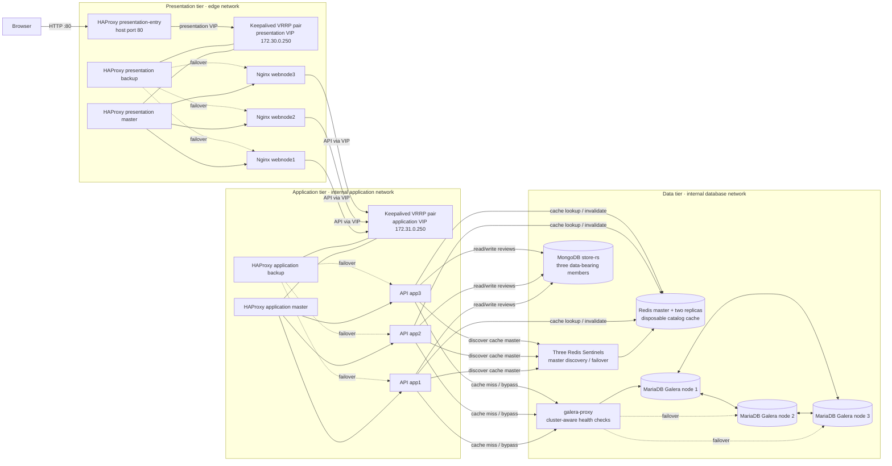

# Distributed three-tier store demo

The stack serves a static storefront through three Nginx presentation nodes. Its
Node.js application tier queries a MariaDB Galera cluster for the ten cheapest
products, caches that list in Redis, and stores product reviews in MongoDB.
HAProxy instances distribute requests within each tier, and Keepalived provides
a master/backup virtual IP for each HAProxy pair.

Data availability now uses a three-member MongoDB replica set, three Redis nodes
with three Sentinels, and a Galera-aware SQL proxy. Redis is disposable cache;
catalog reads bypass it during outages. See [DATA-HA.md](./DATA-HA.md) for routing,
connection budgets, existing-volume precautions and pending live acceptance tests.

## Architecture

Product-list requests check Redis first; a cache miss queries MariaDB and then
populates Redis. Review requests use MongoDB, with MariaDB used to verify the
product before a review is inserted. In this single-host Compose setup, host
port 80 is published by `presentation-entry`, which forwards to the presentation
VIP. This entry container is itself a single point of failure.

## Run locally

1. Copy `.env.example` to `.env` and replace the example passwords.
2. Start the stack with `docker compose up --build`.
3. Open `http://localhost/` for the storefront and
   `http://localhost:8088/` for Nagios.

The product endpoint is `http://localhost/api/products/cheapest`; it returns
JSON sorted by ascending price. The storefront calls this endpoint and renders
the returned products. Schema creation and sample data insertion are
idempotently performed by `catalog-init` through the Galera proxy, after the
MongoDB replica-set initialization job succeeds. Read the existing-data precautions
in [DATA-HA.md](./DATA-HA.md) before applying this topology to populated volumes.

The storefront also displays a live request pipeline for its product and
review API requests. The API's `X-Request-Trace` response header records the
presentation load balancer, selected web node, application load balancer,
application node, and the actual data stores touched by that request.
The storefront API explorer menu can query `/`, `/health`,
`/products/cheapest`, and `/products/ST-001/reviews`.

Use the storefront's API explorer menu to query the product, review, service
information, and health endpoints. Its **Clear Redis catalog cache** button
calls `POST /api/cache/clear`, which deletes only the cheapest-products cache
entry; the next catalog request refills it from MariaDB.

The application uses Redis to cache the cheapest-products response for 60
seconds. MongoDB stores product reviews: use
`GET /api/products/ST-001/reviews` to read reviews or send JSON such as
`{"reviewer":"Taylor","rating":5,"comment":"Great bag."}` to
`POST /api/products/ST-001/reviews` to add one. The initialization service
creates the review index and inserts sample reviews idempotently. MongoDB and
Redis are private to the database network and are not published on host ports.

## Load-balancer failover

The presentation VIP is `172.30.0.250` and the application VIP is
`172.31.0.250`. Each Keepalived pair shares its HAProxy container's network
namespace, uses unicast VRRP, and tracks the local HAProxy listener. Application
requests from Nginx use the floating application VIP.

Compose publishes host port 80 on `presentation-entry`, which targets the floating
presentation VIP. The entry container and the Compose host remain single points
of failure even when both Keepalived pairs and data replication are configured.
