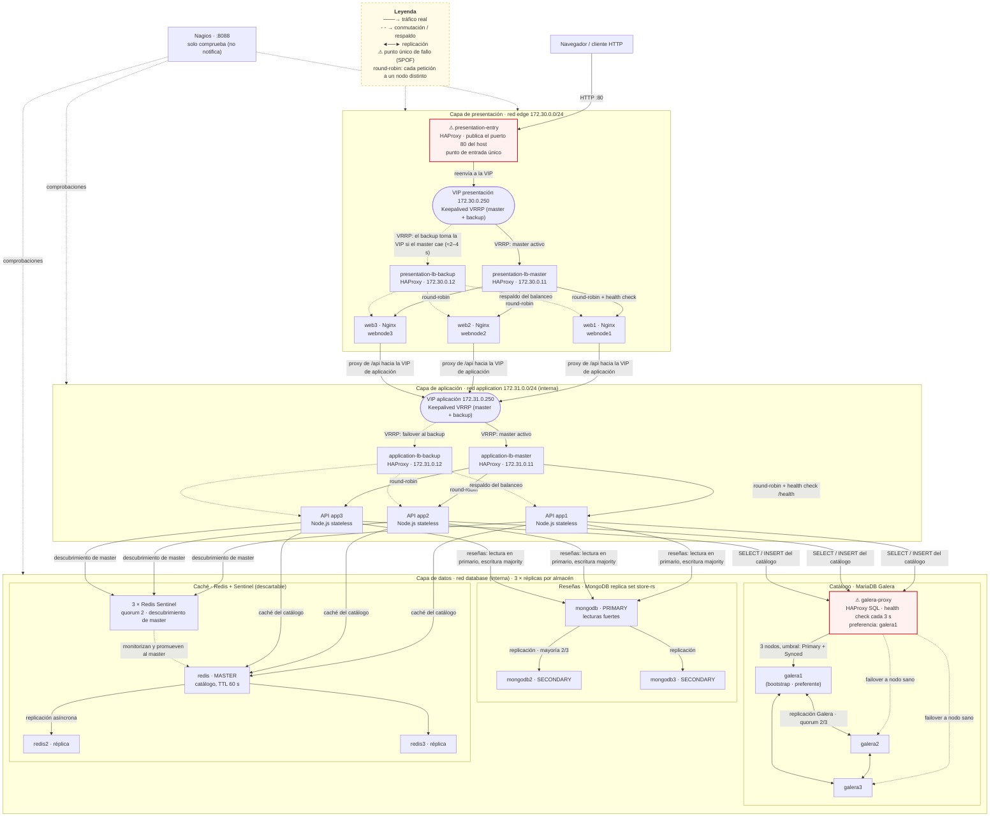

# Tienda de tres capas sobre Docker Compose

> Documento de la entrega para el Wiki del repositorio `IanDiaz05/distributedsystems`.
> Compañeros de esta entrega:
> [`INFORME-WIKI.md`](INFORME-WIKI.md) ·
> [`tests/matriz-pruebas.md`](tests/matriz-pruebas.md) ·
> [`pruebas/01-BASELINE-RENDIMIENTO.md`](pruebas/01-BASELINE-RENDIMIENTO.md) ·
> [`pruebas/02-FAILOVER-PRESENTACION-APLICACION.md`](pruebas/02-FAILOVER-PRESENTACION-APLICACION.md) ·
> [`pruebas/03-FAILOVER-DATOS.md`](pruebas/03-FAILOVER-DATOS.md) ·
> [`pruebas/04-CHAOS-ENGINEERING.md`](pruebas/04-CHAOS-ENGINEERING.md) ·
> [`pruebas/05-OBSERVABILIDAD.md`](pruebas/05-OBSERVABILIDAD.md)

---

## 1. Visión general

Es **una tienda online de tres capas** (presentación, aplicación, datos) desplegada
como un único proyecto de **Docker Compose en un solo host**. El proyecto
`distributed-three-tier` define **32 servicios**: **29 contenedores en ejecución**
más **3 trabajos de inicialización** que terminan con estado `Exited (0)`
(`catalog-init`, `mongodb-init`, `mongodb-keyfile`).

El objetivo académico es demostrar **redundancia a nivel de proceso y failover
detectable**, no alta disponibilidad del host: cada componente crítico aparece
duplicado o triplicado dentro del mismo motor Docker, con mecanismos de detección
y conmutación (VIP VRRP, health checks de HAProxy, quorum de Galera, mayoría de
MongoDB, quorum de Sentinel).

Además del stack principal existen dos piezas auxiliares:

| Pieza | Puerto | Función |
|---|---|---|
| `nagios` (servicio del stack) | `8088 → 80` | Comprobaciones de estado de todos los servicios |
| `resilience-lab/` (proyecto Compose separado) | `8090` | Panel de pruebas: ApacheBench, Siege, JMeter y Chaos Monkey. Se conecta a la red `distributed-three-tier_edge` |

---

## 2. Diagrama de Arquitectura

---

## 3. Infraestructura como código (IaC)

Todo el sistema es reproducible a partir de archivos versionados; no hay
configuración manual dentro de los contenedores.

| Archivo / carpeta | Qué controla |
|---|---|
| `docker-compose.yml` | Los 32 servicios, 3 redes, 13 volúmenes, healthchecks y dependencias de arranque |
| `.env` (desde `.env.example`) | Credenciales y parámetros (fuera del control de versiones) |
| `haproxy/*.cfg` | 5 balanceadores: entry, presentación maestro/respaldo, aplicación maestro/respaldo |
| `database/galera-proxy/` | Imagen y script de comprobación SQL externa de Galera |
| `keepalived/` | Dockerfile + configuración VRRP de cada par (master/backup, presentación/aplicación) |
| `web/nginx.conf`, `web/site1-3/` | Configuración y contenidos de los 3 Nginx |
| `application/` | API Node.js, `init-db.js`, pruebas `node --test application/data-ha.test.js` |
| `database/catalog.sql` | Esquema y datos de muestra del catálogo |
| `mongodb/init-replica.js` | Inicialización idempotente del replica set |
| `redis/start-node.sh`, `redis/start-sentinel.sh` | Arranque con detección de rol master/réplica/sentinel |
| `nagios/architecture.cfg` | Comprobaciones de Nagios (sin notificaciones) |
| `resilience-lab/` | Proyecto Compose del laboratorio de pruebas |
| `DATA-HA.md`, `docs/START-DOWN.md` | Decisiones de disponibilidad de datos y arranque/parada ordenada |

---

## 4. Modelo de redundancia

| Componente | Mecanismo | Qué tolera | Qué **no** tolera |
|---|---|---|---|
| Balanceadores (×2 por capa) | VIP VRRP + health checks HAProxy | Caída del HAProxy maestro (VIP al backup en pocos segundos) | Caída de los dos LB a la vez; pérdida del host |
| Nginx (×3) | Round-robin con health check; `X-Request-Trace` lo demuestra | 1 o 2 nodos caídos (T10/T11) | Pérdida de los tres; saturación (ver curva de T03) |
| APIs (×3) | Estado stateless detrás del LB | 1 o 2 APIs caídas (T12) | — |
| Galera (×3) | Quorum 2/3 + `galera-proxy` con comprobación SQL cada 3 s | 1 nodo caído con quorum conservado (T14/T15) | 2 nodos caídos (pierde quorum); caída del propio `galera-proxy` (SPOF) |
| MongoDB (×3) | Mayoría 2/3, elección automática de primario | Caída del primario con elección (T16) | 2 miembros caídos: sin primario, escrituras fallan visiblemente (T17) |
| Redis (×3) + Sentinel (×3) | Quorum 2, promoción automática | Caída del master (T18) o de un Sentinel (T19) | Pérdida total de la caché es aceptable por diseño: es descartable |
| Nagios (×1) | Comprobaciones periódicas | — | Es único y **no notifica**; solo comprueba (T25) |

